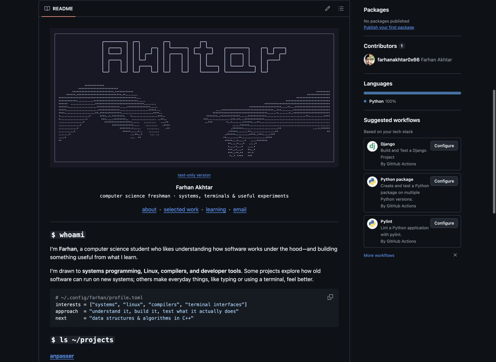
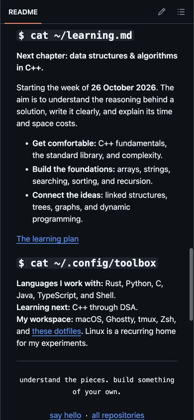

# Profile refresh verification — 24 October 2026

## Content and sources

- Consulted the owner's linked awesome-profile collection and the Orhun,
  Maximous Black and fnky examples listed in `profile-design.md`.
- Checked the READMEs of anpasser, hayate, terminal-ascii-screensaver, dotfiles,
  and JalNet before writing their descriptions. Kept experimental/demo limits.
- Retained every project destination from the preceding profile, moving the
  secondary projects into a disclosure rather than deleting them.
- Kept the approved header markup, canonical art, and generated SVG unchanged.
- DSA in C++ is described as planned for the week of 26 October 2026, based on
  the owner's "next week" statement on Saturday, 24 October. No existing DSA
  work, solved-problem totals, proficiency scores, or coding-platform identity
  is invented.

## Checks

- `python3 -m unittest discover -s tests -v`: 3 static-header tests pass, including a regression check for wordmark
  alignment in the text-only fallback.
- `python3 scripts/generate_creation.py --check`: generated assets are current.
- `git diff --check`: no whitespace errors.
- Local link/anchor audit: all four top navigation destinations exist, the
  learning-plan file exists, and every prior project URL remains present.
- Actual GitHub branch README inspected on desktop and a 390-pixel viewport;
  header and profile sections fit without page-level horizontal overflow.
  The project disclosure, in-page learning link, and linked roadmap were checked.

The hand SVG has a fixed Mocha canvas and remains static. GitHub supplies the
surrounding text colors for its selected theme. Tests used the Codex in-app
browser in dark appearance, not a physical device or a cross-browser matrix.
The wider text-only art alternative can scroll by design.

The live profile does not change until the draft pull request is merged.

