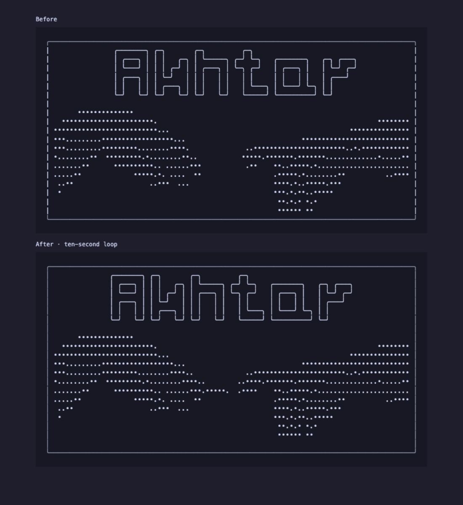
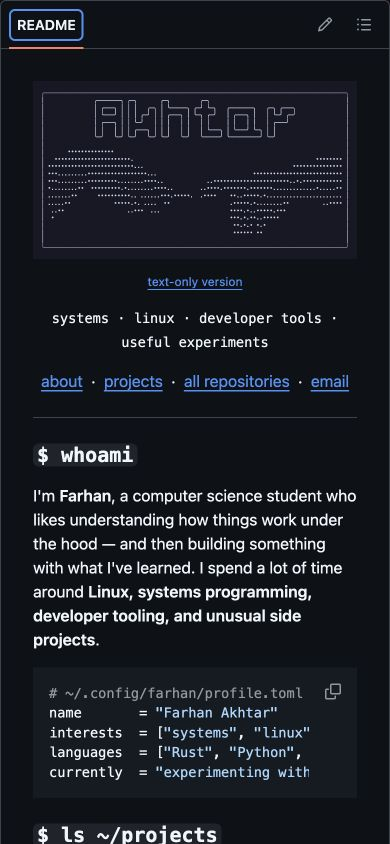
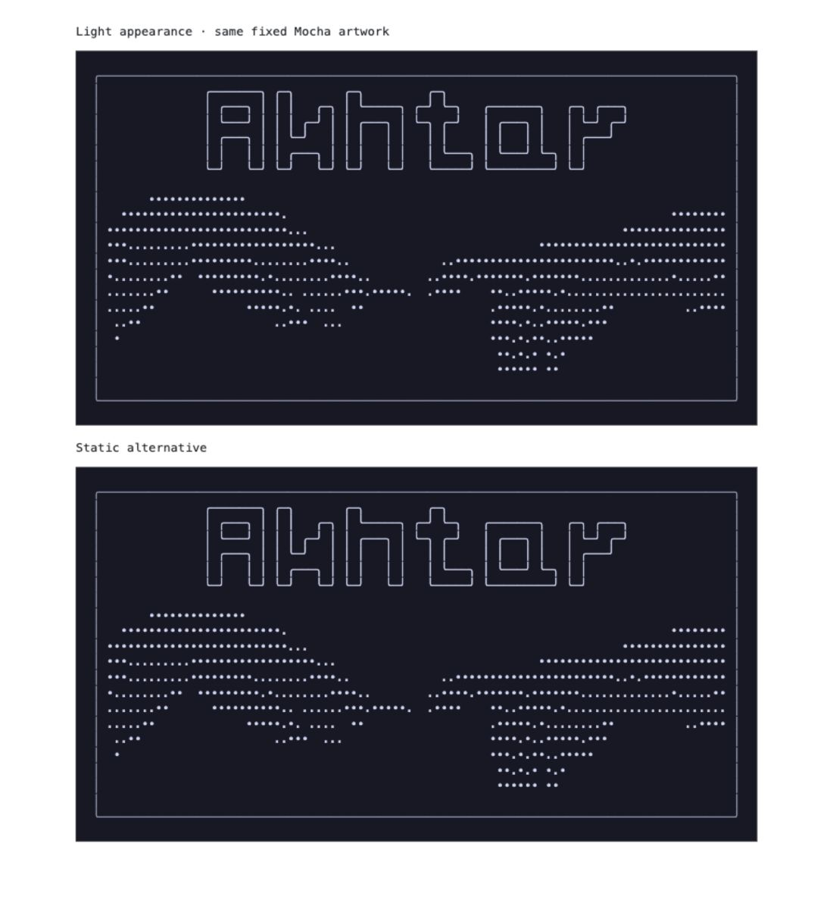

# Verification — 24 October 2026

## Result

The branch README renders and animates on GitHub in the Codex in-app browser.
A GIF fallback was unnecessary. The live profile stays unchanged until the PR
is merged. Tests of a branch README are evidence for GitHub's Markdown renderer,
not a claim that an unmerged branch has replaced the public profile.

## Checks performed

- `python3 -m unittest discover -s tests -v`: 2 tests pass. Checks include
  deterministic generation, valid XML, text glyphs rather than traced paths,
  absence of scripts/external image references, and fingertip geometry.
- The geometry regression test was observed failing before the correction:
  one trailing left-tip dot was outside its movement group. It passes with the
  entire distal tip included and the spark centered at column 46.5. At maximum
  approach, the glyph origins remain 19 SVG units apart, leaving at least one
  nine-unit cell clear after accounting for glyph width.
- `git diff --check`: passes.
- README content after the original header is byte-for-byte unchanged against
  `origin/main` (`491d91c`). Existing projects, descriptions and links are intact.
- Canonical artwork: 22 rows, 93 single-width columns; no combining characters,
  tabs or double-width characters. Original wordmark glyphs preserved.
- GitHub branch README: 45 screenshots over 11.05 seconds. Comparing consecutive
  samples within the artwork found 28 unchanged pairs and 16 changing pairs.
  All changed pixels were confined to the central fingertip area
  (162 × 34 pixels in the 838-pixel-wide rendered image). No palms, lettering
  or border moved. The complete still scene remained visible throughout.
- Local peak-phase fixture: browser-computed spark opacity `0.8`, lavender fill
  `rgb(180,190,254)`, and fingertip displacement `4px`. The final spark uses the
  same stipple glyph as the hands, with its origin centered between the tips.
- Actual GitHub widths: 1440 desktop, 900 narrow desktop, 390 phone, and 320 small
  phone. At 900, 390 and 320, DOM measurements reported no page overflow.
  Header image widths were 538, 324 and 254 pixels respectively. The full hands,
  centered title and symmetric frame remained visible. Fine dots become small
  on phones; the linked text version provides full-size scrollable text.
- GitHub preserves the `<picture>` source with the exact
  `(prefers-reduced-motion: reduce)` media condition and static asset URL.
  Internal SVG CSS also disables both motion and the spark for that preference.
- Inspected the animated and static compositions on a local white-background
  fixture. The matte Mocha canvas keeps the same contrast in either appearance.
- A code reviewer found no substantive implementation issue; the missing
  verification report identified in review is supplied by this file.

## Limits

Tested in one desktop browser engine with emulated viewport sizes, not physical
phones or a Firefox/Safari/Chrome matrix. GitHub itself was in dark appearance;
light surrounding-page appearance was checked in a local fixture. Actual OS
reduced-motion switching was not exercised: source preservation and CSS were
checked, and the static fallback was rendered. No live-profile claim is made
before merge. CSS animation degrades to the complete still composition wherever
animation is disabled or unsupported.

GitHub/raw image caches can delay branch asset refreshes. The embed includes a
version query; increment it after a future asset change if a stale image persists.

## Previews

Screenshots are verification documents, not raster artwork used in the header.

