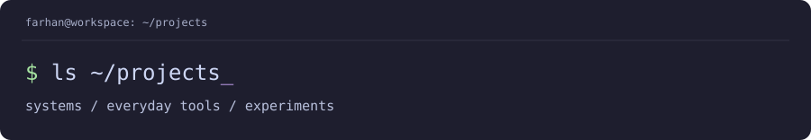

[← Back to profile](../README.md)

  

# My projects

I build to understand the pieces: how programs move between platforms, how a keyboard feels, and how evidence becomes something useful. This is the directory of my public repositories, including team work, my workspace, and what I'm learning next.

[Systems & tools](#systems--tools) · [Field & evidence](#field--evidence) · [Learning](#learning) · [Fork & profile](#fork--profile)

---

## Systems & tools

### 01 / [anpasser](https://github.com/farhanakhtar0x66/anpasser)

**Recover code. Transform behavior. Compile native.** 
`Rust` `Ghidra` `Clang / LLVM` · **Experimental research**

An ahead-of-time Windows game conversion experiment. It explores binary recovery, compiler passes, and native API migration, then compares Windows and Linux behavior to check what survived the conversion.

The current evidence covers constrained inputs and original test games. **It is not a universal game converter; arbitrary Win32/DirectX games are not supported, and Need for Speed SE is not playable.**

[Read the approach](https://github.com/farhanakhtar0x66/anpasser#how-it-works) · [Inspect the evidence](https://github.com/farhanakhtar0x66/anpasser#evidence-not-hype) · [Research roadmap](https://github.com/farhanakhtar0x66/anpasser/blob/main/docs/ROADMAP.md)

### 02 / [hayate](https://github.com/farhanakhtar0x66/hayate)

**Six letter keys. A different way to type.** 
`Java` `Android` `offline` · **Android keyboard**

Tap or flick to reach all 26 letters, choose offline spelling suggestions, and switch to a programmer mode for coding punctuation and indentation. Hayate is an Android input method inspired by the credited HoneyKey Latin layout.

**No network permission.** Suggestions stay on the device.

  
  

[Learn to flick](https://github.com/farhanakhtar0x66/hayate#type) · [Download an APK](https://github.com/farhanakhtar0x66/hayate/releases) · [Privacy](https://github.com/farhanakhtar0x66/hayate/blob/main/PRIVACY.md)

### 03 / [terminal-ascii-screensaver](https://github.com/farhanakhtar0x66/terminal-ascii-screensaver)

**Give a waiting terminal something to do.** 
`Python` `Linux` `macOS` · **Terminal utility**

Editable ASCII artwork with text effects, inspired by Omarchy. Optional automatic mode covers a running task after idle time, dismisses on input, and restores the terminal when the task finishes. It reuses Omarchy's `ttfx` or the Python TerminalTextEffects engine.

[Install](https://github.com/farhanakhtar0x66/terminal-ascii-screensaver#install) · [Customize the artwork](https://github.com/farhanakhtar0x66/terminal-ascii-screensaver#customize-your-artwork) · [Automatic mode](https://github.com/farhanakhtar0x66/terminal-ascii-screensaver#automatic-triggering-bash-and-zsh)

### 04 / [dotfiles](https://github.com/farhanakhtar0x66/dotfiles)

**The workspace behind the work.** 
`Shell` `macOS` `Catppuccin Mocha` · **Personal configuration**

AeroSpace, SketchyBar, Ghostty, tmux, Zsh, Starship, and Fastfetch brought together with a shared palette and XDG layout. The installer backs up existing configuration and links the repository into the workspace.

  

[See the setup](https://github.com/farhanakhtar0x66/dotfiles#features--components) · [Installation](https://github.com/farhanakhtar0x66/dotfiles#one-line-installation)

---

## Field & evidence

### 05 / JalNet

**Water observations, private evidence, and route warnings.** 
`TypeScript` `React Native / Expo` `Cedar` · **Team prototype · local/demo**

An Android prototype connecting a citizen's water report to a human-confirmed incident and a warning when it intersects a saved route. Private-report operations use the real Cedar authorization engine in the local workflow.

Two public repositories preserve the project's development:

- **[jalnet](https://github.com/farhanakhtar0x66/jalnet)** — original implementation, specification, and development history.
- **[jalnet-submission](https://github.com/farhanakhtar0x66/jalnet-submission)** — restored submission workspace, current local demonstration, and engineering evidence. Its migration notes explain the relationship to the original.

**Cloud deployment is unverified.** Local assessment uses manual classification, and routes are straight-line demo corridors.

  
  

Local/demo screens with synthetic reports and routes.

[Current feature scope](https://github.com/farhanakhtar0x66/jalnet-submission/blob/main/docs/FEATURE_STATUS.md) · [Local demonstration](https://github.com/farhanakhtar0x66/jalnet-submission#run-the-local-app) · [Migration provenance](https://github.com/farhanakhtar0x66/jalnet-submission/blob/main/MIGRATION.md)

### 06 / [LEX — Setowa](https://github.com/farhanakhtar0x66/LEX)

**Follow the evidence from field visit to report.** 
`Python` `FastAPI` `SQLite` `Cloudinary` `Gemini` · **Team LEX · hackathon project**

Setowa is the reference platform in the LEX repository: organise cleanup photos and videos by site and visit, compare changes, review AI proposals, and produce source-linked public reports. Human review decides what reaches the official reporting workflow.

[Project & workflow](https://github.com/farhanakhtar0x66/LEX#what-setowa-does) · [Repository](https://github.com/farhanakhtar0x66/LEX)

---

## Learning

### 07 / [dsa-cpp](https://github.com/farhanakhtar0x66/dsa-cpp)

**Learn the reasoning. Write it clearly.** 
`C++` `data structures` `algorithms` · **Starting the week of 26 October 2026**

A new practice repository for learning C++ and DSA. The intended sequence moves from the language and standard library through arrays, searching, sorting, recursion, and then linked structures, trees, graphs, and dynamic programming.

Solutions will include the reasoning and time/space costs as practice begins. The topic folders and templates are ready for the first upload.

[Practice repository](https://github.com/farhanakhtar0x66/dsa-cpp) · [Learning plan](../learning/cpp-dsa.md)

### 08 / [arasaka-deepdata-2026](https://github.com/farhanakhtar0x66/arasaka-deepdata-2026)

**Prepare a repeatable workflow for an unfamiliar dataset.** 
`Python` `scikit-learn` `Streamlit` · **Team practice scaffold**

A DeepData hackathon preparation kit with CSV profiling, tabular classification/regression baselines, a descriptive EDA app, and timed mock challenges. The bundled datasets are synthetic; the exercises are original practice material.

The aim is a repeatable preparation workflow before a timed challenge.

[Tooling & setup](https://github.com/farhanakhtar0x66/arasaka-deepdata-2026#quick-start-linux--macos) · [Workflow](https://github.com/farhanakhtar0x66/arasaka-deepdata-2026#minimal-workflow-for-an-unknown-dataset)

---

## Fork & profile

### 09 / [omarchy](https://github.com/farhanakhtar0x66/omarchy)

`Linux` · **Fork of [omacom/omarchy](https://github.com/omacom/omarchy)**

My fork of the upstream Omarchy Linux distribution. The original distribution is maintained by the upstream authors.

[My fork](https://github.com/farhanakhtar0x66/omarchy) · [Upstream project](https://github.com/omacom/omarchy)

### 10 / [farhanakhtar0x66](https://github.com/farhanakhtar0x66/farhanakhtar0x66)

`Markdown` `SVG` · **Profile & project directory**

The repository behind my GitHub profile: the static AKHTAR artwork, a short introduction, this project directory, and the C++ learning plan.

[Back to the profile](../README.md) · [Text-only artwork](../art/README-static.md)

---

  <samp>understand the pieces. build something of your own.</samp>  
  <a href="../README.md">profile</a> &nbsp;·&nbsp;
  <a href="https://github.com/farhanakhtar0x66?tab=repositories">public repositories</a> &nbsp;·&nbsp;
  <a href="mailto:farhanakhtar0x66@gmail.com">say hello</a>

